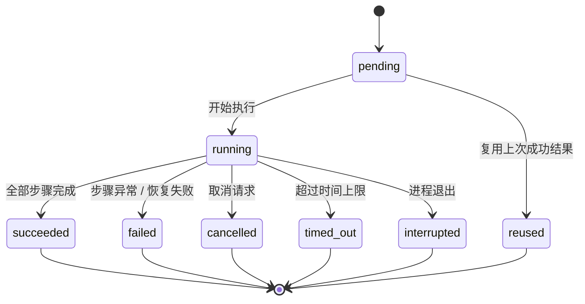

# 远程采集任务编排与状态机

本文档对应任务 3.2（MKACG-775），是 `backend/src/system_analyzer/collection/` 的设计与验收依据。
状态转换表在两处同时存在，必须逐条一致：代码是唯一真值（`collection/states.py`），
本文档是它的文字版；`tests/test_collection_states.py` 会读本文档的两张转换表并逐条对照代码，
不同步就直接失败。

- 范围：任务的阶段划分、状态定义与转换、超时、取消、失败处理、阶段级幂等、中断恢复、
  采集日志与操作记录。
- 不在范围：具体采集什么（3.4 资源、3.5 Journal、3.6 LightDM 登录）、数据回传（3.7）、
  采集管理界面（4.1）、`remote/` 的任何改动。

## 1. 三个阶段

| 阶段 | 值 | 做什么 | 谁填真实动作 |
| --- | --- | --- | --- |
| Pre | `pre` | 环境检查、备份要改的配置、应用临时配置 | 检查与备份已实现；临时配置由 3.4、3.6 填 |
| In Progress | `in_progress` | 启动采样、触发桌面登录、持续采集 | 已实现：`collection/sampling.py` 调用 3.4 资源采集与 3.5 Journal 采集，3.6 负责桌面登录 |
| Post | `post` | 停止采样、收集数据、恢复环境 | 已实现：一次性采样窗口无需停止后台进程；3.7 负责打包回传，恢复步骤按备份清单执行 |

阶段顺序固定为 Pre → In Progress → Post，不可跳过、不可换序。「产出结果」不是单独一步，
而是编排在每个阶段边界写入的执行记录（见第 6 节）。

配置了 `options.delivery` 的采集任务才会执行采样：没有回传就没有消费方。采样记录写在本次
采集临时目录的 `sampling-records.jsonl` 里，Journal 导出文件写在同目录的 `journal/` 下，
Post 阶段的打包直接读取这些文件，不要求采集器先向存储层写入一条「已导入」的采集。

采样器是同步插件，放在工作线程里执行。阶段超时或收到取消时，编排先等待已经在跑的采样线程
结束，再进入 Post 或下一次尝试：旧线程不会与 Post、重试同时读写同一个临时目录。

**Post 无条件执行**：Pre 或 In Progress 失败、取消、超时后，Post 仍然要跑完。Post 自己不响应
取消请求——取消的时候更需要它把目标机器的配置恢复回去。

## 2. 阶段状态

| 状态 | 含义 |
| --- | --- |
| `pending` | 还没开始。每次尝试的三个阶段都从这里出发。 |
| `running` | 正在执行。 |
| `succeeded` | 本阶段全部步骤执行完成。 |
| `reused` | 本次尝试没有重跑，直接复用上一次成功尝试的结果。 |
| `failed` | 步骤抛异常，或清理阶段的恢复动作失败。 |
| `cancelled` | 收到取消请求后停下。 |
| `timed_out` | 超过本阶段的时间上限。 |
| `interrupted` | 执行该阶段时进程退出（Worker 被杀、机器重启），任务后来被重新领取。 |

`succeeded`、`reused`、`failed`、`cancelled`、`timed_out`、`interrupted` 都是终态：一次尝试里
不会再离开它们。重试不复用终态，而是开启一条新的尝试（见第 5 节）。

### 阶段状态转换

| 从 | 到 | 什么时候发生 |
| --- | --- | --- |
| pending | running | 开始执行该阶段 |
| pending | reused | 上一次尝试已经成功，本次直接复用 |
| running | succeeded | 全部步骤执行完成 |
| running | failed | 某个步骤抛异常，或清理阶段的恢复动作失败 |
| running | cancelled | 步骤之间的取消检查发现取消请求 |
| running | timed_out | 超过阶段的 `limit_seconds` |
| running | interrupted | 上一次尝试在该阶段执行期间进程退出 |

## 3. 任务（一次尝试）状态

| 状态 | 含义 |
| --- | --- |
| `pending` | 开始一次尝试。 |
| `running` | 正在执行三个阶段之一。 |
| `succeeded` | 三个阶段全部成功。 |
| `failed` | 某个阶段失败（含清理阶段的恢复动作失败）。 |
| `cancelled` | 收到取消请求并停下。 |
| `timed_out` | 某个阶段超时。 |
| `interrupted` | 执行期间进程退出（Worker 被杀、机器重启），任务后来被重新领取；没有确定的结束时间。 |

### 任务状态转换

| 从 | 到 | 什么时候发生 |
| --- | --- | --- |
| pending | running | 开始一次采集尝试 |
| running | succeeded | 三个阶段全部成功 |
| running | failed | 某个阶段失败，或清理阶段失败 |
| running | cancelled | 收到取消请求 |
| running | timed_out | 某个阶段超过时间上限 |
| running | interrupted | 执行期间进程退出，任务被重新领取 |

### 状态转换图



任务状态与阶段状态共用同一张图的骨架，只是任务状态没有 `reused`：一次尝试不会「复用」，
它要么执行、要么不开始。

## 4. 每条转换对应的测试

阶段转换（`tests/test_collection_states.py`）：

| 转换 | 测试用例（`pytest -k` 可选中） |
| --- | --- |
| pending → running | `test_phase_transition[pending->running]` 与 `test_running_phase_transitions_in_order` |
| pending → reused | `test_phase_transition[pending->reused]` 与 `test_retry_reuses_succeeded_phases` |
| running → succeeded | `test_phase_transition[running->succeeded]` |
| running → failed | `test_phase_transition[running->failed]` 与 `test_phase_failure_still_runs_post_and_restores` |
| running → cancelled | `test_phase_transition[running->cancelled]` 与 `test_cancel_marks_phase_cancelled_and_restores` |
| running → timed_out | `test_phase_transition[running->timed_out]` 与 `test_timeout_marks_phase_timed_out_and_restores` |
| running → interrupted | `test_phase_transition[running->interrupted]` 与 `test_start_attempt_marks_dangling_phase_interrupted` |

任务转换：

| 转换 | 测试用例 |
| --- | --- |
| pending → running | `test_attempt_transition[pending->running]` |
| running → succeeded | `test_attempt_transition[running->succeeded]` |
| running → failed | `test_attempt_transition[running->failed]` |
| running → cancelled | `test_attempt_transition[running->cancelled]` |
| running → timed_out | `test_attempt_transition[running->timed_out]` |
| running → interrupted | `test_attempt_transition[running->interrupted]` 与 `test_start_attempt_marks_dangling_phase_interrupted` |

表外转换（例如 `pending → succeeded`、`succeeded → running`）一律抛 `InvalidTransition`，
由 `test_invalid_phase_transition_is_rejected`、`test_invalid_attempt_transition_is_rejected` 与
`test_terminal_phase_states_have_no_outgoing_transition` 覆盖。

## 5. 重试、中断恢复与幂等

一次采集任务可以被重试（任务行的 `max_attempts`）与中断恢复（Worker 被杀后任务被重新领取）。
两种情况的记录都是**追加一次尝试**，不复用上一次尝试的状态机：

1. 上一次尝试（以及它里面还挂在 `running` 的阶段）先被改成 `interrupted` 并写明原因——记录里
   不会留下一个永远「正在执行」的阶段。中断的尝试没有确定的结束时间，`finished_at` 留空。
2. 新尝试继承上一次尝试的 `data`（备份清单等）。
3. 新尝试开始时：上一次尝试里 `succeeded` 或 `reused` 的阶段直接标成 `reused`，不重新执行；
   Post 例外，每次都执行。

阶段级幂等的含义就是上面第 3 条：**重跑同一阶段不产生新的副作用**，因为重跑根本不会再发生；
它的效果由上一次的成果承担，可以通过 `attempts[-1].phases[...].status == "reused"` 与
「目标机器上没有新的下载与命令」一起验证（`test_rerunning_a_phase_does_not_duplicate_side_effects`）。

Post 每次尝试都执行，所以它的动作必须可重复执行而不改变结果：`restore_configuration` 上传的
始终是 Pre 备份下来的同一份内容，重复上传得到的还是同一份远端文件。

备份同样是「每次采集一次」而不是「每次尝试一次」：记录里已经有备份清单时 `backup_configuration`
不再下载。否则重试时若 Pre 需要重跑，会把目标机器上**已被临时配置改过**的内容当成原始配置保存，
Post 再把改过的内容写回去，记录却显示成功。实测见 `test_backup_is_taken_once_per_collection`。

## 6. 记录：可查询的采集日志与操作记录

记录写在任务行的 `jobs.payload.result.collection`（`collection/record.py`）：

```json
{
  "run_id": "采集任务 id",
  "target_id": "目标机器 id",
  "attempts": [
    {
      "attempt": 1,
      "status": "failed",
      "started_at": "2026-11-12T06:00:00+00:00",
      "finished_at": "2026-11-12T06:00:12+00:00",
      "resumed_from": null,
      "phases": [
        {"phase": "pre", "status": "succeeded", "started_at": "…", "finished_at": "…", "detail": null},
        {"phase": "in_progress", "status": "failed", "started_at": "…", "finished_at": "…",
         "detail": "步骤「启动采样」失败：SshTimeoutError: …"},
        {"phase": "post", "status": "succeeded", "started_at": "…", "finished_at": "…", "detail": null}
      ],
      "events": [
        {"at": "…", "kind": "phase_started", "phase": "pre", "step": null, "detail": null},
        {"at": "…", "kind": "step_started", "phase": "pre", "step": "检查目标环境", "detail": null},
        {"at": "…", "kind": "phase_failed", "phase": "in_progress", "step": null,
         "detail": "步骤「启动采样」失败：…"}
      ],
      "data": {"system_info": {"hostname": "uos-PC"}, "backup": {"paths": ["…"], "files": {"…": "0.bak"}}}
    }
  ]
}
```

- 每个阶段的开始、结束、失败原因都在 `phases` 与 `events` 里，`GET` 任务状态时随
  `payload.result` 一起读出来。
- `kind` 的取值：`phase_started`、`phase_finished`、`phase_reused`、`phase_failed`、
  `step_started`、`step_finished`、`orchestration_failed`。最后一种表示编排自身出错（写采集记录
  失败、取消检查失败），与「步骤失败」分开记：条目的 `detail` 里有原始异常类型。
- 记录在每次阶段开始、阶段结束、步骤结束时都写回一次，所以进程被杀后能知道停在哪个步骤。

## 7. 超时、取消与失败

| 情形 | 编排的行为 | 任务结果 |
| --- | --- | --- |
| 阶段超时 | 阶段记 `timed_out`，随后执行 Post；Post 有独立的超时上限 | `timed_out`，抛 `CollectionJobFailed`，按重试策略重跑 |
| 取消 | 在下一个步骤之前停下，阶段记 `cancelled`，随后执行 Post（Post 不响应取消） | `cancelled`，任务记为成功结束，不重跑；临时目录删除 |
| 步骤失败 | 阶段记 `failed`，`detail` 写明步骤名与异常，随后执行 Post | `failed`，抛 `CollectionJobFailed`，按重试策略重跑 |
| 写采集记录失败 / 取消检查失败 | 折算成阶段失败并补一条 `orchestration_failed` 事件；**Post 照常执行**，且 Post 阶段自己写记录失败只记日志、不中断恢复动作 | `failed`，抛 `CollectionJobFailed`，按重试策略重跑 |
| Post 恢复失败 | Post 记 `failed`；前面阶段的结论不被覆盖 | `failed`（即使前面是「取消」也记失败：远端没恢复就不算按用户要求结束），任务重试，临时目录与备份保留 |

「取消」与「Post 失败」同时发生时，失败判定优先：只有「取消且清理成功」才算 `cancelled`。
`_discard_scratch` 只在这两种情形下删临时目录，清理失败时备份一定保留下来给下一次尝试用。

对应的用例：`test_record_write_failure_still_runs_post`、`test_cleanup_failure_marks_the_run_failed_even_after_cancel`、
`test_phase_failure_still_runs_post_and_restores`、`test_cancel_marks_phase_cancelled_and_restores`。

超时上限（秒，可由任务 payload 的 `options.phase_timeouts` 按阶段覆盖）：

| 阶段 | 默认上限 | 理由 |
| --- | --- | --- |
| Pre | 300 | 只做检查与备份 |
| In Progress | 1800 | 要等 LightDM 重启与桌面会话建立，还要跑完采样窗口 |
| Post | 300 | 停止、回传与恢复 |

取消的实现：编排在两个步骤之间调用一次取消检查；Worker 处理器把取消检查接到任务行上的
`payload.cancel_requested` —— 取消采集的调用方（4.1 的采集管理界面）往同一行任务写这个字段，
处理器下一次检查就读到它。实测见 `tests/integration/test_collection_jobs_db.py`
的 `test_cancel_flag_stops_the_run_and_still_cleans_up` 与
`test_job_cancel_requested_reads_payload_flag`。

## 8. 并发

一个采集任务只与一台目标机器相关，编排里没有任何跨任务的共享状态：连接由 `TargetConnector`
按 `target_id` 建立、临时目录按 `run_id` 分开、记录写在自己那一行任务上。两台机器同时跑任务
互不影响，实测见 `test_two_targets_run_concurrently_without_interference`。

`run_id` 会拼成本地临时目录名（任务结束时要递归删除），所以处理器只接受 UUID：调用方不传时用
任务 id，传了就必须是 UUID，见 `test_run_id_must_be_a_uuid`。

## 9. 任务锁

`docs/implementation-baseline.md` 第 2.1 节要求「引入采集处理器之前」解决任务执行期间不续租
`locked_at` 的限制。`collection/jobs.py` 的 `renew_job_lock` 在整段执行期间按固定间隔把
`jobs.locked_at` 刷新成当前时间（只在任务仍是 `running` 时更新），因此跑几十分钟的采集不会被
另一个 Worker 当成失锁任务重复领取。单次续租语句失败只记日志、下一轮继续尝试：续租失败不该中断
采集，也不该把一个其实已经成功的任务记成失败；数据库长时间不可用时，后续写采集记录会失败并把
任务记为失败，不会静默跑完。实测见 `tests/integration/test_collection_jobs_db.py` 的
`test_lock_is_renewed_while_job_runs` 与 `tests/test_collection_jobs.py` 的
`test_lock_renewal_keeps_going_after_failed_updates`。

## 10. 已知限制

1. 进程被暴力终止（`kill -9`、断电）时，被中断那次尝试的内存清理动作不会执行；恢复靠下一次
   尝试的 Post 阶段（它按记录里的备份清单执行）。这也是备份清单必须写进记录的原因。
2. 取消检查发生在两个步骤之间，单个步骤内部不响应取消。3.4–3.7 填入长动作时，如果需要在动作
   中间响应取消，把自己的循环拆成多个步骤，而不是在步骤里自行读取消标记。
3. 三个阶段的真实采集动作尚未填入（3.4、3.5、3.6、3.7）。当前带真实实现的步骤是 Pre 的
   「检查目标环境」「备份系统配置」与 Post 的「恢复环境」。
